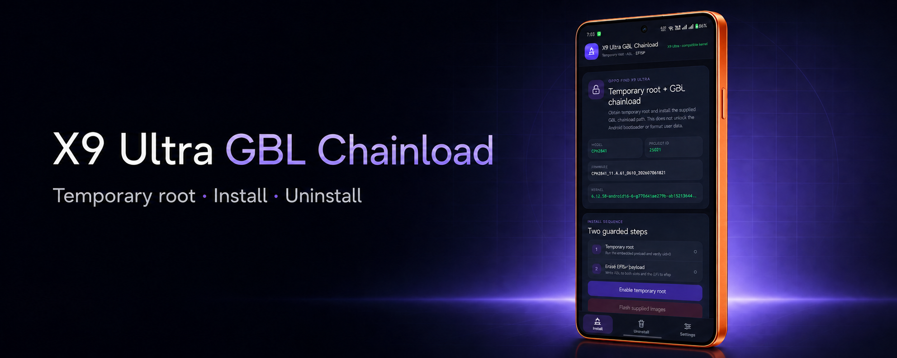

# X9 Ultra GBL Chainload



Standalone Android app for the OPPO Find X9 Ultra. It packages the validated
temporary-root backends and the supplied GBL chainload payloads. It writes
those payloads directly and contains no `unlocker` binary.

This app does **not** unlock the Android bootloader. It enables the supplied
GBL chainload path by writing ABL to both slots and the exact-kernel EFI
payload to the `efisp` partition.

The Uninstall page obtains temporary root, writes the packaged all-zero
`efisp.img` to `efisp`, and reads the entire image back before offering a
reboot to recovery / fastbootd. The user must then enter Recovery and format
data manually; the app never formats user data itself.

Created by [koaaN](https://github.com/koaaN). The matching CVE-2026-43499
exploit and preload builder is available at
[koaaN/x9u-preload-builder](https://github.com/koaaN/x9u-preload-builder).

## Workflow

1. Obtain temporary root: confirm a supported project ID and the exact target
   kernel, run the embedded preload, then verify uid 0 through a
   restricted app-private root broker.
2. After the user types `FLASH`, install the GBL chainload payloads:
   - `abl.img` to `abl_a` and `abl_b`;
   - on 6.12.58, `installed-mode2.efi` to `efisp`;
   - on 6.12.69, `CPH2841_17.0.0.101-mode2-fb.efi` to `efisp`.
3. After all three writes pass read-back verification, reboot to recovery /
   fastbootd and manually format data in Recovery.

The broker exposes only the fixed root, install, uninstall, reboot, and stop
operations required by the app; it does not expose a general root shell.
Before success is shown, the app reads the exact payload length back from each
partition and compares it with the staged image. It removes the preload's
temporary `su` files and restores SELinux enforcing when the broker stops. An
unused broker also expires after 15 minutes.

The app does not unlock the Android bootloader or format user data. The
preload race can panic or reboot the device, and interrupted partition writes
can make it unbootable. The native backend repeats the project-ID and kernel
checks before root and flash operations; the disabled UI buttons are not the
only guard.

## Shizuku setup for kernel 6.12.69

The 6.12.69 backend requires
[Shizuku](https://shizuku.rikka.app/guide/setup/) because the exploit must
start as Android's shell user. Shizuku is not used by the original 6.12.58
preload backend.

1. Install and open Shizuku.
2. Enable **Developer options** and **USB debugging**.
3. On ColorOS, remove the vendor ADB restriction:
   - disable **Permission monitoring**; or
   - on releases that renamed the option, enable
     **Disable system optimisation**.
4. Start Shizuku using either wireless debugging or a computer with ADB.
5. Open this app and grant its Shizuku permission when requested.
6. In **Settings**, optionally run the read-only CVE-2026-98260 profile
   precheck before enabling temporary root.

If Shizuku reports **The permission of adb is limited**, the ColorOS option
in step 3 is still blocking it. A running Shizuku process is not sufficient
until that warning is gone.

Shizuku must be started again after every reboot. Do not retry the temporary-
root chain in the same boot after the app reports a held timer or asks for a
reboot. After a successful flash, wait for `FLASH_VERIFY_OK` and use the app's
reboot control. If flashing fails or times out, do not reboot until the result
has been inspected.

## Hardware-verified 6.12.69 result

Version 0.3.4 completed the full flow on project ID `25021` with kernel:

```text
6.12.69-android16-6-g242e1a07f878-ab15865446-4k
```

The restricted broker obtained uid 0, wrote `abl.img` to both `abl_a` and
`abl_b`, wrote `CPH2841_17.0.0.101-mode2-fb.efi` to `efisp`, and read all
written bytes back successfully. The run finished with `FLASH_VERIFY_OK` and
`INSTALL_VERIFY_OK`. This validation does not make flashing risk-free or
extend support to a different kernel build.

## Unlock the bootloader through GBL

Only continue after the app has successfully installed and verified the GBL
chainload payloads. Unlocking the bootloader erases all user data. Back up
anything important before starting.

1. Reboot the phone.
2. Directly after the phone vibrates during boot, press and hold **Volume Up**
   to enter the GBL chainload bootloader.
3. Connect the phone to a computer with Android Platform Tools installed.
4. Open Command Prompt or a terminal and confirm that fastboot sees it:

   ```text
   fastboot devices
   ```

5. Enable OEM unlocking through GBL:

   ```text
   fastboot oem oem-unlock-toggle
   ```

6. Start the Android bootloader unlock:

   ```text
   fastboot flashing unlock
   ```

7. Confirm the unlock on the phone using its hardware buttons. The phone will
   erase its user data as part of the unlock process.

The app only installs the GBL chainload path. It never runs either unlock
command automatically.

## Supported targets

The supported project IDs are:

```text
25021
25022
25211
```

The project ID is the compatibility gate and is read from the standard OPlus
boot properties, beginning with `ro.boot.prjname`. The reported Android model
is informational and is not paired with a project ID because firmware can
change it. Known labels include `PMA110`, `PMA120`, and `CPH2841`.

The original preload backend is selected only for:

```text
6.12.58-android16-6-g7704a1ae279b-ab15213644-4k
```

That preload is never run on another release.

The app selects CVE-2026-98260 as a second temporary-root backend only for
this exact release:

```text
6.12.69-android16-6-g242e1a07f878-ab15865446-4k
```

On that release, the existing **Enable temporary root** button requests
Shizuku permission, runs the native backend as Android's shell user, and
hands uid 0 to a restricted broker. The normal install, uninstall, read-back
verification, and reboot controls then use that broker. A held timer failure
is marked for the current boot and blocks retries until the phone is rebooted.

The original 6.12.58 preload backend is unchanged. CVE-2026-98260 is never
attempted on it, and neither backend runs for an unknown kernel. The project
ID and exact-release checks are repeated inside the 6.12.69 root broker before
any partition operation.

## Embedded payloads

| File | SHA-256 |
|---|---|
| `libx9upreload.so` | `32ac2f03f56955c41032157aa53f23590c3f6a1595fccc025ad991322e07f7f6` |
| `abl.img` | `4ad7f1db0c92f0a358e28bf18170a20533011299827d8d9a25cffd2218f1415d` |
| `installed-mode2.efi` | `35560f8e6fd706a3768f26f692467491c90425881a8d80bf237341215c04cac5` |
| `CPH2841_17.0.0.101-mode2-fb.efi` (6.12.69 only) | `7e696c2af4da1327d8fab4f1b72a4a1e11a9e1983d0c9342909f1639e6b6adc2` |
| `efisp.img` (3 MiB, all zero) | `bbd05cf6097ac9b1f89ea29d2542c1b7b67ee46848393895f5a9e43fa1f621e5` |

## Build and install

A complete JDK 17 with `javac`, Android SDK 36, Android NDK r29, and Git are
required. The build pins the MIT-licensed native CVE reference at commit
`11c7c82000205db8b2a29f79ee297f124484f2bb` and applies the local exact-kernel
profile before compiling it.

```sh
ANDROID_SDK_ROOT=/tmp/android-sdk \
ANDROID_NDK_HOME=/path/to/android-ndk-r29 \
./build-app.sh
adb install -r dist/x9u-root-flasher-v0.3.4.apk
```

The current local release build uses the Android debug signing key so it is
directly installable for testing. Use a private production keystore before
public distribution.

## Automated releases

`.github/workflows/release.yml` builds and publishes an APK whenever a tag
matching the app version is pushed, such as `v0.3.4`. It can also be run
manually with the same tag. The workflow checks the APK checksum, uploads a
workflow artifact, and creates or updates the corresponding GitHub Release.

The following repository secrets provide a stable signing identity across
releases:

- `X9U_SIGNING_KEYSTORE_BASE64`
- `X9U_SIGNING_STORE_PASSWORD`
- `X9U_SIGNING_KEY_ALIAS`
- `X9U_SIGNING_KEY_PASSWORD`
